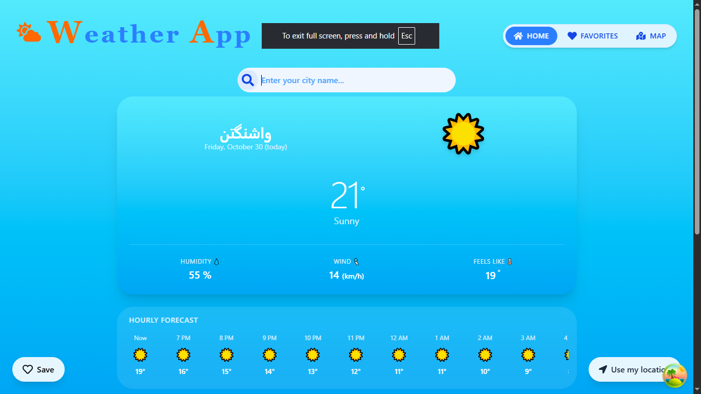
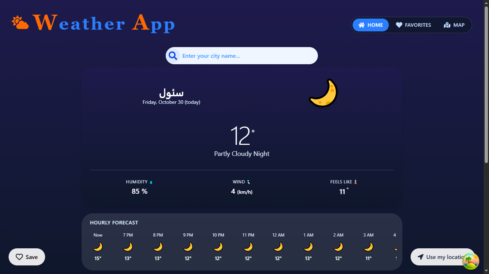
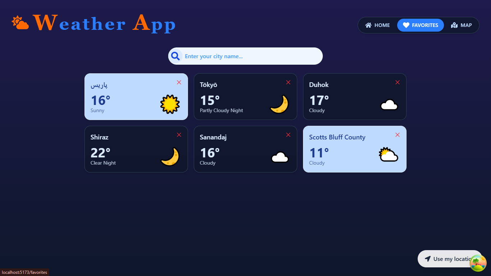
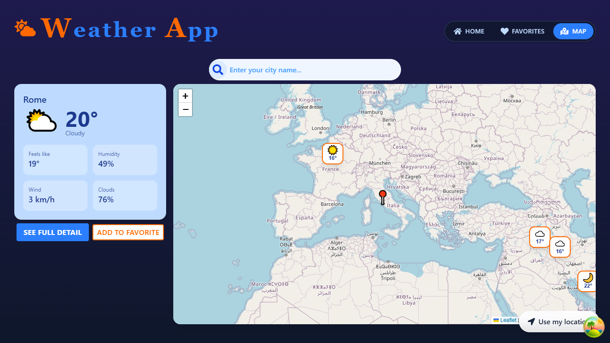
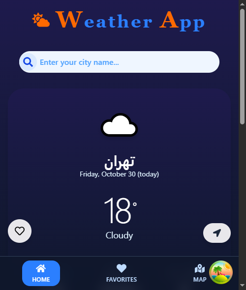
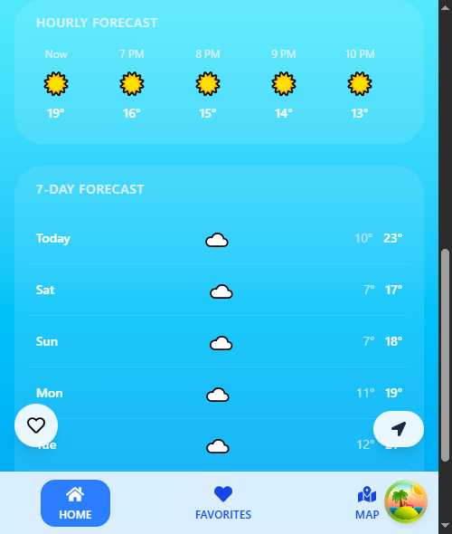

# 🌤️ Weather App

A sleek, responsive weather app built with React and Tailwind CSS. Search any city or use your location, check hourly and 7-day forecasts, save favorite cities, and explore the weather on an interactive map. The UI changes with the time of day at the selected place.


## 📸 Screenshots

### Desktop

| Day Mode ☀️ | Night Mode 🌙 |
| :---: | :---: |
|  |  |

### Favorites and Map

| Favorites ❤️ | Map 🗺️ |
| :---: | :---: |
|  |  |

### Mobile

| Night Mode 🌙 | Day Mode ☀️ |
| :---: | :---: |
|  |  |

## 🚀 Features

- 🔍 **City search:** Find the weather for any city worldwide.
- 📍 **My location:** One tap to see the weather where you are, with the city name.
- 🌓 **Dynamic day/night UI:** Backgrounds and icons follow the local time of the selected place, not your clock.
- ⏱️ **Hourly forecast:** A smooth, horizontally scrollable view.
- 📅 **7-day forecast:** Minimum and maximum temperatures for the week.
- ❤️ **Favorite cities:** Save places (stored in `localStorage`) and see them on a dedicated page as live weather cards. Click a card to open the full forecast.
- 🗺️ **Interactive map:** Click anywhere to see its current weather. Your favorites appear as weather markers with a tooltip.
- 🧭 **Responsive navigation:** A bottom tab bar on phones and a top bar on desktop. The search bar and location button stay available on every page.
- 🛡️ **Robust error handling:** Loading skeletons, error messages with a retry button, and an error boundary so one crash never blanks the app.

## 🛠️ Tech Stack

- **Framework:** React with Vite
- **Styling:** Tailwind CSS
- **Routing:** React Router
- **Data fetching and caching:** TanStack Query (React Query)
- **Map:** Leaflet and React Leaflet
- **Error handling:** react-error-boundary
- **Icons:** React Icons
- **APIs (no API keys needed):**
  - [Open-Meteo](https://open-meteo.com/) for forecasts
  - [Nominatim (OpenStreetMap)](https://nominatim.org/) for city search and reverse geocoding

## 💡 Technical Highlights

- **The URL is the source of truth.** Opening a favorite or clicking the map puts the coordinates in the URL (`?lat=…&lon=…`), so selections survive a refresh and links can be shared.
- **One batched request for all favorites.** Open-Meteo accepts several locations at once, so the favorites page and map markers load with a single call that React Query caches.
- **Search and location persist across pages.** A shared layout owns the search state, so the search bar and the location button work from any page.
- **Timezone-correct theming.** Day and night come from the API's `is_day` value for the selected place, so searching Tokyo at your noon still shows Tokyo's night.
- **Defensive by default.** URL parameters are validated, empty search results throw a clear error, and a failed city-name lookup never blocks the weather.

## 🏃‍♂️ Getting Started

```bash
git clone https://github.com/alire1992/weatherApp.git
cd weatherApp
npm install
npm run dev
```

Open [http://localhost:5173](http://localhost:5173) in your browser. No API key or `.env` file is needed.

## 🌟 Possible Improvements

- [ ] **Unit toggle:** Switch between Celsius and Fahrenheit.
- [ ] **Charts:** Visualize temperature trends with Recharts.
- [ ] **Search on the map page:** Move the map to the searched city.
- [ ] **Weather layers:** Add rain radar to the map.

## 🙏 Acknowledgments

- [Open-Meteo](https://open-meteo.com/) for the free weather API.
- [OpenStreetMap](https://www.openstreetmap.org/copyright) contributors, [Nominatim](https://nominatim.org/) and [Leaflet](https://leafletjs.com/) for the map and geocoding.

---

Made by **Alireza Saedi** · [LinkedIn](https://www.linkedin.com/in/alireza-saedi-dev/) · [GitHub](https://github.com/alire1992)